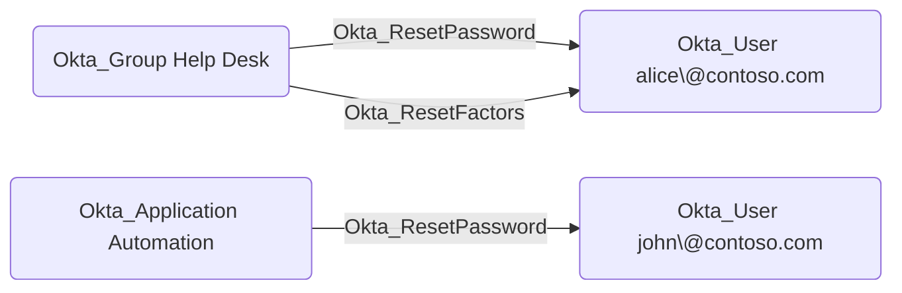
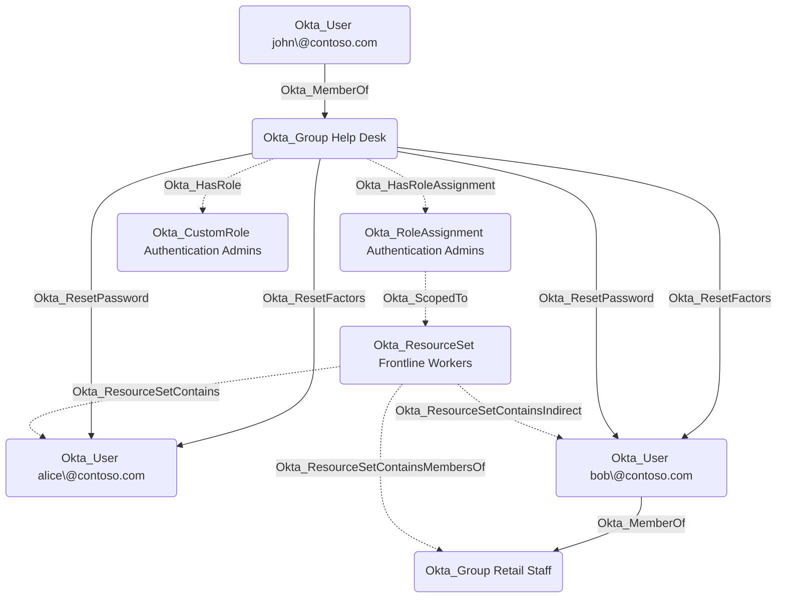

## Edge Schema

- Traversable: ✅

| Source | Destination |
| --- | --- |
| [Okta_Application](/opengraph/extensions/okta/nodes/okta_application) | [Okta_User](/opengraph/extensions/okta/nodes/okta_user) |
| [Okta_Group](/opengraph/extensions/okta/nodes/okta_group) | [Okta_User](/opengraph/extensions/okta/nodes/okta_user) |
| [Okta_User](/opengraph/extensions/okta/nodes/okta_user) | [Okta_User](/opengraph/extensions/okta/nodes/okta_user) |

## General Information

The traversable Okta_ResetPassword edges represent custom role permissions that allow a principal (user, group, or application) to reset passwords or temporary credentials for scoped Okta users. These edges are created when a custom role includes password management permissions such as `okta.users.credentials.resetPassword`, `okta.users.credentials.manage`, `okta.users.credentials.manageTemporaryAccessCode`, or `okta.users.manage`.

The edge is calculated based on custom role scoping.

Alice is a direct member of the resource set, while Bob is a member indirectly through the Retail Staff group. Both are therefore in scope of the role assignment.
