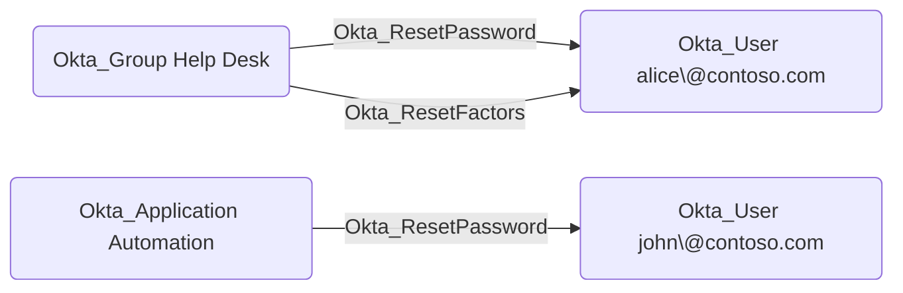
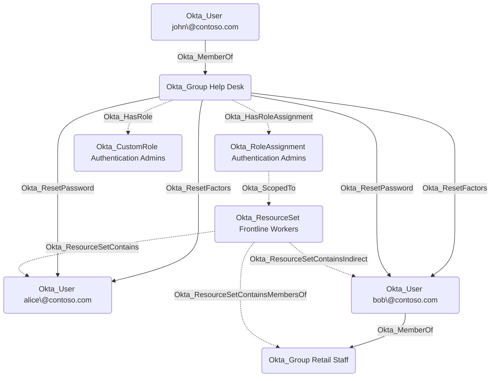

## Edge Schema

- Traversable: ✅

| Source | Destination |
| --- | --- |
| [Okta_Application](/opengraph/extensions/okta/nodes/okta_application) | [Okta_User](/opengraph/extensions/okta/nodes/okta_user) |
| [Okta_Group](/opengraph/extensions/okta/nodes/okta_group) | [Okta_User](/opengraph/extensions/okta/nodes/okta_user) |
| [Okta_User](/opengraph/extensions/okta/nodes/okta_user) | [Okta_User](/opengraph/extensions/okta/nodes/okta_user) |

## General Information

The traversable Okta_ResetPassword edges represent custom role permissions that allow a principal (user, group, or application) to reset passwords or temporary credentials for scoped Okta users. These edges are created when a custom role includes password management permissions such as `okta.users.credentials.resetPassword`, `okta.users.credentials.manage`, `okta.users.credentials.manageTemporaryAccessCode`, or `okta.users.manage`.



The edge is calculated based on custom role scoping.



Alice is a direct member of the resource set, while Bob is a member indirectly through the Retail Staff group. Both are therefore in scope of the role assignment.

## Abuse Info

A controlled source principal can request a password reset for an in-scope user when Okta permits the lifecycle operation. Password authority, administrator protections, recovery configuration, and MFA still apply. A reset capability does not by itself establish an authenticated session. This procedure inspects the target only; a password reset needs a disposable account and an owner-approved recovery plan because the previous password cannot be recovered from Okta.

1. Establish control of the source identity or system described above. Inherited group access requires a controlled member. Use native Okta IDs from the API, not normalized BloodHound object IDs.
2. Inspect **target user status and credential provider** through the matching object in the Okta Admin Console, or use this read-only API check. The token must belong to the identity being assessed; a separate administrator’s token does not prove the source’s access. OAuth callers use `Authorization: Bearer $OKTA_ACCESS_TOKEN` instead.

```bash
export OKTA_ORG="https://example.okta.com"
export OKTA_API_TOKEN="YOUR_CONTROLLED_IDENTITY_TOKEN"
export USER_ID="YOUR_OKTA_USER_ID"
curl -i -sS -H "Authorization: SSWS $OKTA_API_TOKEN" \
  -H "Accept: application/json" "$OKTA_ORG/api/v1/users/$USER_ID"
```

3. Expect HTTP 200 and confirm the response identifies the intended tenant and object. Follow pagination for a complete list. Compare the returned scope, membership, or configuration with the represented relationship; a 403 or an empty response does not prove the relationship is absent. This inspection does not validate additional compromise claims.

## Opsec Considerations

Review password reset/recovery activity, target status, user notifications, and subsequent authentication. Do not place recovery links in shared logs. Review the Okta System Log alongside the relevant source-system logs. The API check above reads state; no environmental change or restoration is included in it. These steps have not been exercised against a lab.


## References

- [User lifecycle operations](https://developer.okta.com/docs/api/openapi/okta-management/management/tags/userlifecycle)
- [Okta System Log](https://developer.okta.com/docs/api/openapi/okta-management/management/tags/systemlog)
