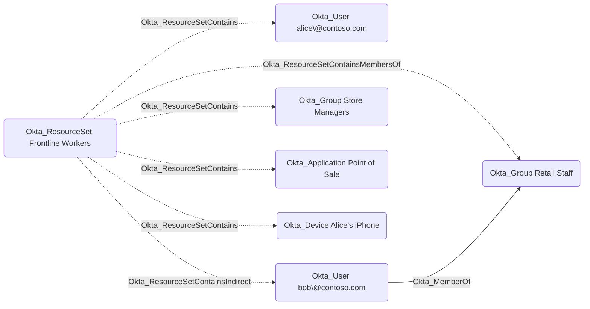

## Edge Schema

- Traversable: ❌

| Source | Destination |
| --- | --- |
| [Okta_ResourceSet](/opengraph/extensions/okta/nodes/okta_resourceset) | [Okta_ApiServiceIntegration](/opengraph/extensions/okta/nodes/okta_apiserviceintegration) |
| [Okta_ResourceSet](/opengraph/extensions/okta/nodes/okta_resourceset) | [Okta_Application](/opengraph/extensions/okta/nodes/okta_application) |
| [Okta_ResourceSet](/opengraph/extensions/okta/nodes/okta_resourceset) | [Okta_AuthorizationServer](/opengraph/extensions/okta/nodes/okta_authorizationserver) |
| [Okta_ResourceSet](/opengraph/extensions/okta/nodes/okta_resourceset) | [Okta_Device](/opengraph/extensions/okta/nodes/okta_device) |
| [Okta_ResourceSet](/opengraph/extensions/okta/nodes/okta_resourceset) | [Okta_Group](/opengraph/extensions/okta/nodes/okta_group) |
| [Okta_ResourceSet](/opengraph/extensions/okta/nodes/okta_resourceset) | [Okta_IdentityProvider](/opengraph/extensions/okta/nodes/okta_identityprovider) |
| [Okta_ResourceSet](/opengraph/extensions/okta/nodes/okta_resourceset) | [Okta_Policy](/opengraph/extensions/okta/nodes/okta_policy) |
| [Okta_ResourceSet](/opengraph/extensions/okta/nodes/okta_resourceset) | [Okta_User](/opengraph/extensions/okta/nodes/okta_user) |

## General Information

The non-traversable Okta_ResourceSetContains edges represent the direct membership relationships between resource sets and their member entities in Okta:

Resource sets can contain users, groups, applications, API service integrations, devices, authorization servers, identity providers, and policies. When a resource set contains a group, only the group object itself is in scope; its members are not.

Okta also allows a resource set to contain the members of a group instead of the group itself. Such memberships are represented by the [Okta_ResourceSetContainsMembersOf](/opengraph/extensions/okta/edges/okta_resourcesetcontainsmembersof) edge to the group and by [Okta_ResourceSetContainsIndirect](/opengraph/extensions/okta/edges/okta_resourcesetcontainsindirect) edges to the users who are members of that group. The union of Okta_ResourceSetContains and [Okta_ResourceSetContainsIndirect](/opengraph/extensions/okta/edges/okta_resourcesetcontainsindirect) edges therefore covers all objects that a role assignment scoped to the resource set applies to.

These edges are informational. The effective permissions granted by custom roles scoped to a resource set are represented by dedicated traversable edges, such as [Okta_ResetPassword](/opengraph/extensions/okta/edges/okta_resetpassword), [Okta_AddMember](/opengraph/extensions/okta/edges/okta_addmember), and [Okta_ManageApp](/opengraph/extensions/okta/edges/okta_manageapp).
