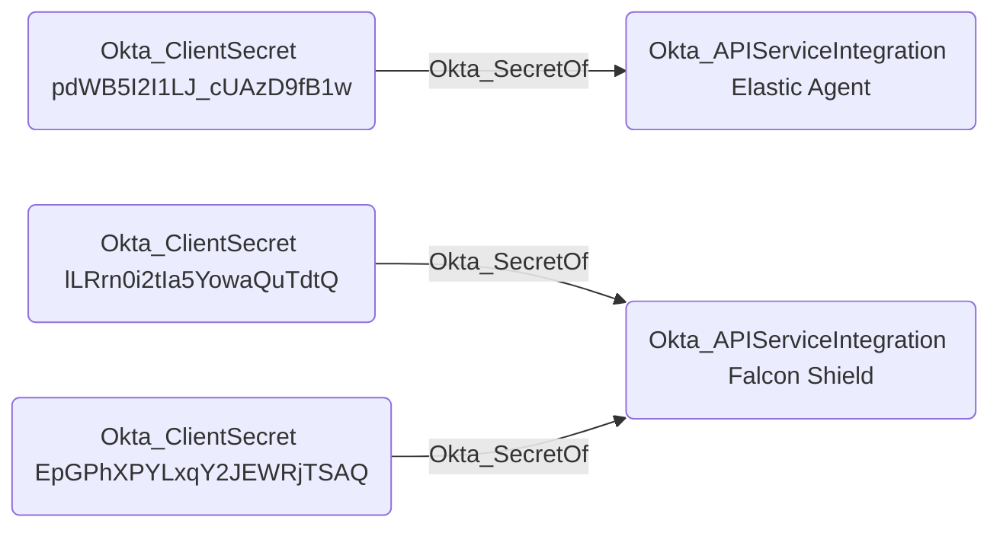

## Edge Schema

- Traversable: ✅

| Source | Destination |
| --- | --- |
| [Okta_ClientSecret](/opengraph/extensions/okta/nodes/okta_clientsecret) | [Okta_ApiServiceIntegration](/opengraph/extensions/okta/nodes/okta_apiserviceintegration) |
| [Okta_ClientSecret](/opengraph/extensions/okta/nodes/okta_clientsecret) | [Okta_Application](/opengraph/extensions/okta/nodes/okta_application) |

## General Information

The traversable Okta_SecretOf edges represent the relationship between service applications or API service integrations and their associated client secrets, represented by the [Okta_ClientSecret](/opengraph/extensions/okta/nodes/okta_clientsecret) nodes.



## Abuse Info

A usable client secret can authenticate the linked client only through that client’s configured authentication flow. Graph secret identifiers and hashes are not raw credentials. An OIN API service integration and a custom OAuth service app have different token authentication requirements; do not assume a secret can replace a private key.

1. Establish control of the source identity or system described above. Inherited group access requires a controlled member. Use native Okta IDs from the API, not normalized BloodHound object IDs.
2. Inspect **linked application configuration** through the matching object in the Okta Admin Console, or use this read-only API check. The token must belong to the identity being assessed; a separate administrator’s token does not prove the source’s access. OAuth callers use `Authorization: Bearer $OKTA_ACCESS_TOKEN` instead.

```bash
export OKTA_ORG="https://example.okta.com"
export OKTA_API_TOKEN="YOUR_CONTROLLED_IDENTITY_TOKEN"
export APP_ID="YOUR_OKTA_APPLICATION_ID"
curl -i -sS -H "Authorization: SSWS $OKTA_API_TOKEN" \
  -H "Accept: application/json" "$OKTA_ORG/api/v1/apps/$APP_ID"
```

3. Expect HTTP 200 and confirm the response identifies the intended tenant and object. Follow pagination for a complete list. Compare the returned scope, membership, or configuration with the represented relationship; a 403 or an empty response does not prove the relationship is absent. This inspection does not validate additional compromise claims.

## Opsec Considerations

Review client token requests and subsequent API activity; secret rotation and reads are separate activities. Never record bearer tokens or client secrets in evidence. Review the Okta System Log alongside the relevant source-system logs. The API check above reads state; no environmental change or restoration is included in it. These steps have not been exercised against a lab.


## References

- [API service integration authentication](https://developer.okta.com/docs/guides/build-api-integration/main/)
- [Okta System Log](https://developer.okta.com/docs/api/openapi/okta-management/management/tags/systemlog)
