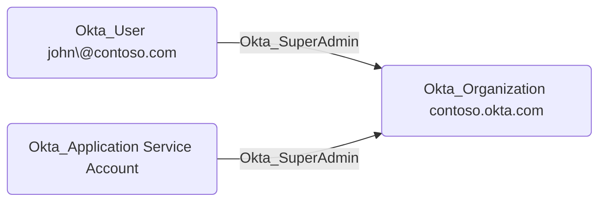

## Edge Schema

- Traversable: ✅

| Source | Destination |
| --- | --- |
| [Okta_Application](/opengraph/extensions/okta/nodes/okta_application) | [Okta_Organization](/opengraph/extensions/okta/nodes/okta_organization) |
| [Okta_Group](/opengraph/extensions/okta/nodes/okta_group) | [Okta_Organization](/opengraph/extensions/okta/nodes/okta_organization) |
| [Okta_User](/opengraph/extensions/okta/nodes/okta_user) | [Okta_Organization](/opengraph/extensions/okta/nodes/okta_organization) |

## General Information

The traversable Okta_SuperAdmin edges represent Super Administrator role assignments to the Okta organization. Super Administrators have full access to all features and settings in the Okta organization.



## Abuse Info

Authenticate as the principal with the current SUPER_ADMIN assignment. For group-sourced access, control an authorized member. For a service app, use its configured credential and scopes. The organization read below verifies tenant context only; full administrative authority must also be confirmed from the actual role assignment.

1. Establish control of the source identity or system described above. Inherited group access requires a controlled member. Use native Okta IDs from the API, not normalized BloodHound object IDs.
2. Inspect **organization control boundary** through the matching object in the Okta Admin Console, or use this read-only API check. The token must belong to the identity being assessed; a separate administrator’s token does not prove the source’s access. OAuth callers use `Authorization: Bearer $OKTA_ACCESS_TOKEN` instead.

```bash
export OKTA_ORG="https://example.okta.com"
export OKTA_API_TOKEN="YOUR_CONTROLLED_IDENTITY_TOKEN"
curl -i -sS -H "Authorization: SSWS $OKTA_API_TOKEN" \
  -H "Accept: application/json" "$OKTA_ORG/api/v1/org"
```

3. Expect HTTP 200 and confirm the response identifies the intended tenant and object. Follow pagination for a complete list. Compare the returned scope, membership, or configuration with the represented relationship; a 403 or an empty response does not prove the relationship is absent. This inspection does not validate additional compromise claims.

## Opsec Considerations

Correlate administrator assignments and security configuration changes with the source identity. A token scoped to reads may exercise only a subset of the role’s authority. Review the Okta System Log alongside the relevant source-system logs. The API check above reads state; no environmental change or restoration is included in it. These steps have not been exercised against a lab.


## References

- [User role assignments and targets](https://developer.okta.com/docs/api/openapi/okta-management/management/tags/roleassignmentauser)
- [Okta System Log](https://developer.okta.com/docs/api/openapi/okta-management/management/tags/systemlog)

- [Standard administrator permissions and restrictions](https://help.okta.com/en-us/Content/topics/security/administrators-admin-comparison.htm)
