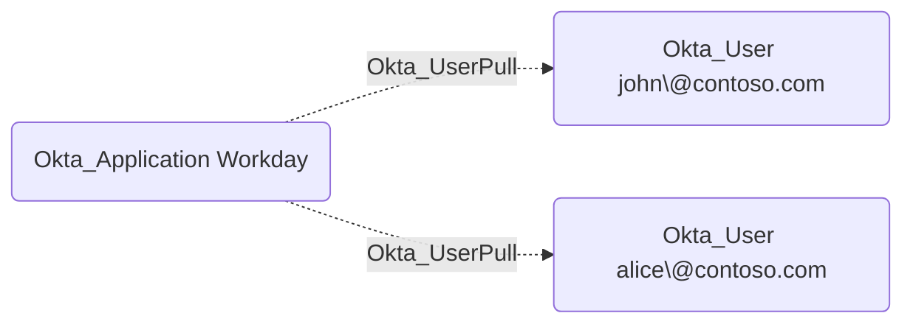

## Edge Schema

- Traversable: ❌

| Source | Destination |
| --- | --- |
| [Okta_Application](/opengraph/extensions/okta/nodes/okta_application) | [Okta_User](/opengraph/extensions/okta/nodes/okta_user) |

## General Information

The Okta_UserPull edges represent user import relationships from external applications to Okta.

## References

- [SCIM provisioning and source authority](https://developer.okta.com/docs/concepts/scim/)
