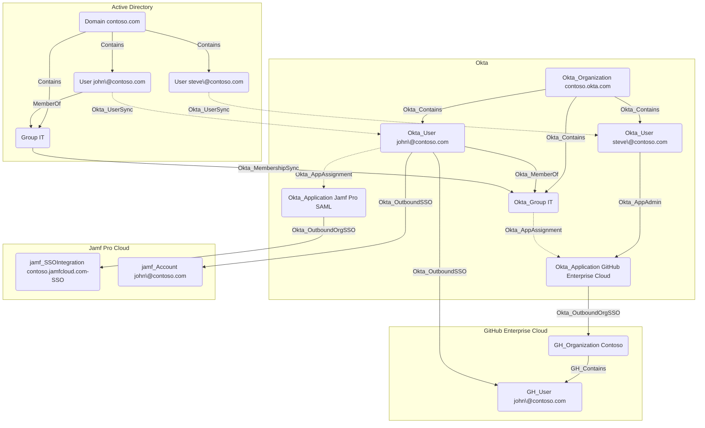

## Overview

Applications in Okta represent the various software applications and services that users can access through the Okta organization. Applications can be configured to use different authentication methods, such as SAML, OIDC, or SWA. These protocols can either be configured manually by administrators or automatically by adding an application from Okta's App Integration Catalog, which provides a wide range of pre-configured cloud and on-premises application templates.

With the exception of API Service applications, Okta users and groups can be assigned to applications. Users can also be synchronized TO and FROM applications in Okta, typically using the SCIM protocol. For example, when integrating with GitHub Enterprise Cloud, Okta can be configured to automatically create user accounts in GitHub when users are assigned to the GitHub application in Okta.

Okta applications are represented as Okta_Application nodes.

## [User](/resources/nodes/user) Name Mapping

[User](/resources/nodes/user) name mapping from Okta to SAML 2.0, OpenID Connect (OIDC), and Secure Web Authentication (SWA) applications is configurable in the Okta Admin Console, with the default setting being the Okta username pass-through, i.e., `${source.login}`.

| Application username format   | Mapping template                                            |
|-------------------------------|-------------------------------------------------------------|
| Okta username                 | `${source.login}`                                           |
| Email                         | `${source.email}`                                           |
| Okta username prefix          | `${fn:substringBefore(source.login, "@")}`                  |
| Email prefix                  | `${fn:substringBefore(source.email, "@")}`                  |
| AD Employee ID                | `${source.employeeID}`                                      |
| AD SAM account name           | `${source.samAccountName}`                                  |
| AD SAM account name + domain  | `${source.samAccountName}@${source.instance.namingContext}` |
| AD user principal name        | `${source.userName}`                                        |
| AD user principal name prefix | `${fn:substringBefore(source.userName, "@")}`               |
| (None)                        | `NONE`                                                      |
| Custom                        | ?                                                           |

## API Service Applications

This application type is the most interesting one from the security perspective, as it represents OAuth 2.0 service (daemon) applications that can be granted machine-to-machine access to Okta APIs, without any user interaction. These applications can be assigned administrative roles, e.g., Super Admin, and OAuth 2.0 scope grants, e.g., `okta.users.manage`. Any API operation must be allowed by both the assigned roles and the granted scopes.

## Hybrid Edges

For supported systems like Active Directory, GitHub Enterprise Cloud, or Jamf Pro, OpenHound can create hybrid edges in BloodHound to represent the relationships between these external systems and Okta.

### Active Directory Synchronization

When Okta's Active Directory (AD) integration is configured for user and group synchronization, the connected AD domain is represented as an Okta_Application node in BloodHound. This allows you to visualize the AD-backed application alongside other applications in your Okta environment and understand its relationships with users, groups, and roles.

The synchronization is performed by domain-joined servers with the Okta AD Agent installed. This agent typically has Domain Admin privileges in the connected AD domain to perform user and group enumeration and synchronization, making it a high-value target for attackers.

Authentication can be delegated from Okta to AD in multiple ways:

- [Agentless Desktop SSO](https://help.okta.com/oie/en-us/content/topics/directory/ad-dsso-about-workflow.htm)
- [Password Synchronization](https://help.okta.com/oie/en-us/content/topics/directory/installing_configuring_active_directory_password_sync_agent.htm)
- Active Directory Federation Services (ADFS) integration with Okta as a SAML IdP

<Info>
There is no documented API available to determine the authentication delegation method(s) configured for an AD-backed Okta application. The collector therefore performs some heuristics that might not be 100% accurate in all cases.
</Info>

### GitHub Enterprise Cloud Organizations

When integrating Okta with GitHub Enterprise Cloud, each GitHub organization connected to Okta is represented as a separate Okta_Application node in BloodHound.

### Jamf Pro

When integrating Okta with Jamf Pro using SAML 2.0, each Jamf Pro instance connected to Okta is represented as a separate Okta_Application node in BloodHound. The differentiator is the `domainFQDN` property:

It is also possible to integrate Jamf Pro with Okta using Secure Web Authentication (SWA), but this option is less secure.

## Google Workspace

Similarly to the Jamf Pro SAML applications, each Google Workspace (formerly G Suite) instance connected to Okta using SAML 2.0 is represented as a separate Okta_Application node in BloodHound and is identified by the `domainFQDN` property:

The SAML 2.0 protocol should always be preferred to SWA when integrating Okta with Google Workspace:

## Generic SAML 2.0 Applications

The assertion consumer service (ACS) URLs of generic (non-Catalog) Okta SAML 2.0 applications are exposed via the `url` attribute in BloodHound.

### OIN catalog SAML routes

Okta Integration Network (OIN) applications do not expose their SAML routes in
one uniform API shape. OpenHound prefers a complete route reported directly in
`settings.signOn`. When that route is absent, it can use a reviewed, bundled
resolver for these catalog families:

- Asana
- GitHub Enterprise Cloud and Enterprise Managed Users
- Jamf Pro
- Okta Org2Org
- Palo Alto Networks GlobalProtect
- Slack
- Zoom single-vanity URLs
- Miro standard and complete custom routes

Resolver-derived routes fail closed when required account, domain, or route
settings are missing or malformed. OpenHound does not infer a route for an
unsupported catalog family merely from the application name.

Safe route-related `settings.app` values are exposed as normalized application
properties. `saml_route_setting_fields` records which supported fields were
present in the Okta response, including fields whose value was explicitly null.
The field-presence property is significant: an omitted field is not treated as
proof that a catalog default was selected. Null values themselves are not
written as BloodHound properties.

See [Okta OIN SAML route evidence](https://github.com/SpecterOps/openhound-okta/blob/585901d44b5536ac78ae6184ef9c60bc1001bb6f/docs/saml-oin-route-evidence.md) for the
resolver contract, evidence boundaries, supported variants, and deferred
families.

## Generic Secure Web Authentication (SWA) Applications

Secure Web Authentication (SWA) is an Okta technology that provides Single Sign-On (SSO) functionality to external web applications that don't support federated protocols. SWA applications store user credentials in Okta and automatically fill them in when users access the application through the Okta dashboard.

The app's login page URL is exposed via the `url` attribute in BloodHound.

## Generic OpenID Connect (OIDC) Applications

Okta supports three types of OIDC applications:

- Web Application
- Single-Page Application (SPA)
- Native Application

The default redirect URI of generic (non-Catalog) Okta OIDC single-page applications (SPAs) starts with `http://localhost:8080/`, making it hard to identify the actual application address. The optional Okta-initiated sign-in flow URL is therefore exposed in the `url` attribute in BloodHound instead, if configured.

OIDC applications can be granted OAuth 2.0 scopes to access Okta APIs on behalf of users:

## SCIM-Enabled Applications

The `features` attribute of Okta_Application nodes may contain the following SCIM-related values, indicating if SCIM is enabled and which protocol capabilities are supported:

| Feature                      | Description                                                                    |
|------------------------------|--------------------------------------------------------------------------------|
| PUSH_NEW_USERS               | Supports pushing new users from Okta to the application                        |
| PUSH_PASSWORD_UPDATES        | Supports pushing password updates from Okta to the application                 |
| PUSH_PENDING_USERS           | Supports pushing users from Okta to the application in pending state          |
| PUSH_PROFILE_UPDATES         | Supports pushing profile updates from Okta to the application                  |
| PUSH_USER_DEACTIVATION       | Supports pushing user deactivation from Okta to the application                |
| REACTIVATE_USERS             | Supports reactivating users in the application from Okta                       |
| IMPORT_NEW_USERS             | Supports importing new users into Okta from the application                    |
| OPP_SCIM_INCREMENTAL_IMPORTS | Supports incremental imports of users from the application into Okta           |
| IMPORT_PROFILE_UPDATES       | Updates a linked user's app profile in Okta during manual or scheduled imports |
| GROUP_PUSH                   | Supports pushing groups and group memberships from Okta to the application     |
| PROFILE_MASTERING            | Supports profile mastering in Okta, allowing the application to be the source of truth for user profiles |

## Edges

### Inbound Edges

| Edge | Source Node | Traversable |
| --- | --- | --- |
| [Okta_AgentPoolFor](/opengraph/extensions/okta/edges/okta_agentpoolfor) | [Okta_AgentPool](/opengraph/extensions/okta/nodes/okta_agentpool) | ✅ |
| [Okta_AppAdmin](/opengraph/extensions/okta/edges/okta_appadmin) | Okta_Application | ✅ |
| [Okta_AppAdmin](/opengraph/extensions/okta/edges/okta_appadmin) | [Okta_Group](/opengraph/extensions/okta/nodes/okta_group) | ✅ |
| [Okta_AppAdmin](/opengraph/extensions/okta/edges/okta_appadmin) | [Okta_User](/opengraph/extensions/okta/nodes/okta_user) | ✅ |
| [Okta_AppAssignment](/opengraph/extensions/okta/edges/okta_appassignment) | [Okta_Group](/opengraph/extensions/okta/nodes/okta_group) | ❌ |
| [Okta_AppAssignment](/opengraph/extensions/okta/edges/okta_appassignment) | [Okta_User](/opengraph/extensions/okta/nodes/okta_user) | ❌ |
| [Okta_Contains](/opengraph/extensions/okta/edges/okta_contains) | [Okta_Organization](/opengraph/extensions/okta/nodes/okta_organization) | ✅ |
| [Okta_GroupPush](/opengraph/extensions/okta/edges/okta_grouppush) | [Okta_Group](/opengraph/extensions/okta/nodes/okta_group) | ❌ |
| [Okta_KerberosSSO](/opengraph/extensions/okta/edges/okta_kerberossso) | [User](/resources/nodes/user) | ✅ |
| [Okta_KeyOf](/opengraph/extensions/okta/edges/okta_keyof) | [Okta_JWK](/opengraph/extensions/okta/nodes/okta_jwk) | ✅ |
| [Okta_ManageApp](/opengraph/extensions/okta/edges/okta_manageapp) | Okta_Application | ✅ |
| [Okta_ManageApp](/opengraph/extensions/okta/edges/okta_manageapp) | [Okta_Group](/opengraph/extensions/okta/nodes/okta_group) | ✅ |
| [Okta_ManageApp](/opengraph/extensions/okta/edges/okta_manageapp) | [Okta_User](/opengraph/extensions/okta/nodes/okta_user) | ✅ |
| [Okta_PolicyMapping](/opengraph/extensions/okta/edges/okta_policymapping) | [Okta_Policy](/opengraph/extensions/okta/nodes/okta_policy) | ❌ |
| [Okta_ResourceSetContains](/opengraph/extensions/okta/edges/okta_resourcesetcontains) | [Okta_ResourceSet](/opengraph/extensions/okta/nodes/okta_resourceset) | ❌ |
| [Okta_ScopedTo](/opengraph/extensions/okta/edges/okta_scopedto) | [Okta_RoleAssignment](/opengraph/extensions/okta/nodes/okta_roleassignment) | ❌ |
| [Okta_SecretOf](/opengraph/extensions/okta/edges/okta_secretof) | [Okta_ClientSecret](/opengraph/extensions/okta/nodes/okta_clientsecret) | ✅ |
| [Okta_UserPush](/opengraph/extensions/okta/edges/okta_userpush) | [Okta_User](/opengraph/extensions/okta/nodes/okta_user) | ❌ |

### Outbound Edges

| Edge | Destination Node | Traversable |
| --- | --- | --- |
| [Okta_AddMember](/opengraph/extensions/okta/edges/okta_addmember) | [Okta_Group](/opengraph/extensions/okta/nodes/okta_group) | ✅ |
| [Okta_AppAdmin](/opengraph/extensions/okta/edges/okta_appadmin) | [Okta_ApiServiceIntegration](/opengraph/extensions/okta/nodes/okta_apiserviceintegration) | ✅ |
| [Okta_AppAdmin](/opengraph/extensions/okta/edges/okta_appadmin) | Okta_Application | ✅ |
| [Okta_GroupAdmin](/opengraph/extensions/okta/edges/okta_groupadmin) | [Okta_Group](/opengraph/extensions/okta/nodes/okta_group) | ✅ |
| [Okta_GroupAdmin](/opengraph/extensions/okta/edges/okta_groupadmin) | [Okta_User](/opengraph/extensions/okta/nodes/okta_user) | ✅ |
| [Okta_GroupMembershipAdmin](/opengraph/extensions/okta/edges/okta_groupmembershipadmin) | [Okta_Group](/opengraph/extensions/okta/nodes/okta_group) | ✅ |
| [Okta_GroupPull](/opengraph/extensions/okta/edges/okta_grouppull) | [Okta_Group](/opengraph/extensions/okta/nodes/okta_group) | ✅ |
| [Okta_HasRole](/opengraph/extensions/okta/edges/okta_hasrole) | [Okta_CustomRole](/opengraph/extensions/okta/nodes/okta_customrole) | ❌ |
| [Okta_HasRole](/opengraph/extensions/okta/edges/okta_hasrole) | [Okta_Role](/opengraph/extensions/okta/nodes/okta_role) | ❌ |
| [Okta_HasRoleAssignment](/opengraph/extensions/okta/edges/okta_hasroleassignment) | [Okta_RoleAssignment](/opengraph/extensions/okta/nodes/okta_roleassignment) | ❌ |
| [Okta_HelpDeskAdmin](/opengraph/extensions/okta/edges/okta_helpdeskadmin) | [Okta_User](/opengraph/extensions/okta/nodes/okta_user) | ✅ |
| [Okta_ManageApp](/opengraph/extensions/okta/edges/okta_manageapp) | Okta_Application | ✅ |
| [Okta_MobileAdmin](/opengraph/extensions/okta/edges/okta_mobileadmin) | [Okta_Device](/opengraph/extensions/okta/nodes/okta_device) | ✅ |
| [Okta_OrgAdmin](/opengraph/extensions/okta/edges/okta_orgadmin) | [Okta_Device](/opengraph/extensions/okta/nodes/okta_device) | ✅ |
| [Okta_OrgAdmin](/opengraph/extensions/okta/edges/okta_orgadmin) | [Okta_Group](/opengraph/extensions/okta/nodes/okta_group) | ✅ |
| [Okta_OrgAdmin](/opengraph/extensions/okta/edges/okta_orgadmin) | [Okta_User](/opengraph/extensions/okta/nodes/okta_user) | ✅ |
| [Okta_OrgSWA](/opengraph/extensions/okta/edges/okta_orgswa) | [AZTenant](/resources/nodes/az-tenant) | ❌ |
| [Okta_OrgSWA](/opengraph/extensions/okta/edges/okta_orgswa) | [GH_Organization](/opengraph/extensions/github/nodes/gh_organization) | ❌ |
| [Okta_OrgSWA](/opengraph/extensions/okta/edges/okta_orgswa) | [OP_Account](https://github.com/SpecterOps/1PassHound) | ❌ |
| [Okta_OrgSWA](/opengraph/extensions/okta/edges/okta_orgswa) | [SNOW_Account](https://github.com/SpecterOps/SnowHound) | ❌ |
| [Okta_OrgSWA](/opengraph/extensions/okta/edges/okta_orgswa) | [jamf_SSOIntegration](/opengraph/extensions/jamf/nodes/jamf_ssointegration) | ❌ |
| [Okta_OutboundOrgSSO](/opengraph/extensions/okta/edges/okta_outboundorgsso) | [AZTenant](/resources/nodes/az-tenant) | ✅ |
| [Okta_OutboundOrgSSO](/opengraph/extensions/okta/edges/okta_outboundorgsso) | [GH_Organization](/opengraph/extensions/github/nodes/gh_organization) | ✅ |
| [Okta_OutboundOrgSSO](/opengraph/extensions/okta/edges/okta_outboundorgsso) | [OP_Account](https://github.com/SpecterOps/1PassHound) | ✅ |
| [Okta_OutboundOrgSSO](/opengraph/extensions/okta/edges/okta_outboundorgsso) | [Okta_IdentityProvider](/opengraph/extensions/okta/nodes/okta_identityprovider) | ✅ |
| [Okta_OutboundOrgSSO](/opengraph/extensions/okta/edges/okta_outboundorgsso) | [SNOW_Account](https://github.com/SpecterOps/SnowHound) | ✅ |
| [Okta_OutboundOrgSSO](/opengraph/extensions/okta/edges/okta_outboundorgsso) | [jamf_SSOIntegration](/opengraph/extensions/jamf/nodes/jamf_ssointegration) | ✅ |
| [Okta_ReadClientSecret](/opengraph/extensions/okta/edges/okta_readclientsecret) | [Okta_ClientSecret](/opengraph/extensions/okta/nodes/okta_clientsecret) | ✅ |
| [Okta_ReadPasswordUpdates](/opengraph/extensions/okta/edges/okta_readpasswordupdates) | [Okta_User](/opengraph/extensions/okta/nodes/okta_user) | ✅ |
| [Okta_ResetFactors](/opengraph/extensions/okta/edges/okta_resetfactors) | [Okta_User](/opengraph/extensions/okta/nodes/okta_user) | ✅ |
| [Okta_ResetPassword](/opengraph/extensions/okta/edges/okta_resetpassword) | [Okta_User](/opengraph/extensions/okta/nodes/okta_user) | ✅ |
| [Okta_SuperAdmin](/opengraph/extensions/okta/edges/okta_superadmin) | [Okta_Organization](/opengraph/extensions/okta/nodes/okta_organization) | ✅ |
| [Okta_UserPull](/opengraph/extensions/okta/edges/okta_userpull) | [Okta_User](/opengraph/extensions/okta/nodes/okta_user) | ❌ |

## Properties

| Name | Type | Source | Description |
| --- | --- | --- | --- |
| account_id | string &#124; null | ApplicationProperties.account_id | Account id recorded for this object when available. |
| acs_url | string &#124; null | ApplicationProperties.acs_url | Acs url recorded for this object when available. |
| activation_email | string &#124; null | ApplicationProperties.activation_email | Activation email recorded for this object when available. |
| afw_id | string &#124; null | ApplicationProperties.afw_id | Afw id recorded for this object when available. |
| afw_only | bool &#124; null | ApplicationProperties.afw_only | Afw only recorded for this object when available. |
| app_filter | string &#124; null | ApplicationProperties.app_filter | App filter recorded for this object when available. |
| app_type | string | name | App type recorded for this object when available. |
| aud_restriction | string &#124; null | ApplicationProperties.aud_restriction | Aud restriction recorded for this object when available. |
| audience | string &#124; null | ApplicationProperties.audience | Audience recorded for this object when available. |
| audience_restriction | string &#124; null | ApplicationProperties.audience_restriction | Audience restriction recorded for this object when available. |
| audience_uri | string &#124; null | ApplicationProperties.audience_uri | Audience uri recorded for this object when available. |
| aws_environment_type | string &#124; null | ApplicationProperties.aws_environment_type | Aws environment type recorded for this object when available. |
| base_url | string &#124; null | ApplicationProperties.base_url | Base url recorded for this object when available. |
| button_field | string &#124; null | ApplicationProperties.button_field | Button field recorded for this object when available. |
| checkbox | string &#124; null | ApplicationProperties.checkbox | Checkbox recorded for this object when available. |
| client_type | string &#124; null | oauth_client.application_type if oauth_client else None | Client type recorded for this object when available. |
| created | datetime | created | Creation timestamp reported by the source. |
| custom_acs_url | string &#124; null | ApplicationProperties.custom_acs_url | Custom acs url recorded for this object when available. |
| custom_entity_id | string &#124; null | ApplicationProperties.custom_entity_id | Custom entity id recorded for this object when available. |
| datacenter_location | string &#124; null | ApplicationProperties.datacenter_location | Datacenter location recorded for this object when available. |
| destination | string &#124; null | ApplicationProperties.destination | Destination recorded for this object when available. |
| displayname | string | display_name | Readable label supplied by the source object. |
| domain | string &#124; null | ApplicationProperties.domain | Domain recorded for this object when available. |
| domain_name | string &#124; null | ApplicationProperties.domain_name | Domain name recorded for this object when available. |
| domain_sid | string &#124; null | _lookup.application_domain_sid(id) if name == &#39;active_directory&#39; else None | Domain sid recorded for this object when available. |
| domains | list[bool &#124; int &#124; string] &#124; null | ApplicationProperties.domains | Domains recorded for this object when available. |
| enterprise_name | string &#124; null | ApplicationProperties.enterprise_name | Enterprise name recorded for this object when available. |
| entity_id | string &#124; null | ApplicationProperties.entity_id | Entity id recorded for this object when available. |
| environmentid | string | _lookup.org_id() | Graph ID of the containing Okta organization, normalized to uppercase. |
| features | list[string] &#124; null | features | Features recorded for this object when available. |
| filter_groups_by_ou | bool &#124; null | ApplicationProperties.filter_groups_by_ou | Filter groups by ou recorded for this object when available. |
| github_org | string &#124; null | ApplicationProperties.github_org | Github org recorded for this object when available. |
| grant_types | list[string] &#124; null | oauth_client.grant_types if oauth_client else None | Grant types recorded for this object when available. |
| group_filter | string &#124; null | ApplicationProperties.group_filter | [Group](/resources/nodes/group) filter recorded for this object when available. |
| has_role_assignments | bool | _lookup.has_role_assignments(id, &#39;client&#39;) | Whether an administrative assignment was found for this principal. |
| id | string | id | Source identifier used to build the node ID. |
| identity_provider_arn | string &#124; null | ApplicationProperties.identity_provider_arn | Identity provider arn recorded for this object when available. |
| idp_id | string &#124; null | app_setting_properties.pop(&#39;idp_id&#39;, None) | Idp id recorded for this object when available. |
| initiate_login_uri | string &#124; null | ApplicationProperties.initiate_login_uri | Initiate login uri recorded for this object when available. |
| jit_groups_across_domains | bool &#124; null | ApplicationProperties.jit_groups_across_domains | Jit groups across domains recorded for this object when available. |
| join_all_roles | bool &#124; null | ApplicationProperties.join_all_roles | Join all roles recorded for this object when available. |
| label | string | label | Label recorded for this object when available. |
| last_seen | datetime | NodeProperties.last_seen | Timestamp assigned when the collector converts the node. |
| last_updated | datetime &#124; null | last_updated | Last modification timestamp, when available. |
| login | string &#124; null | ApplicationProperties.login | Login recorded for this object when available. |
| login_url | string &#124; null | ApplicationProperties.login_url | Login url recorded for this object when available. |
| login_url_regex | string &#124; null | ApplicationProperties.login_url_regex | Login url regex recorded for this object when available. |
| microsoft_app_id | string &#124; null | ApplicationProperties.microsoft_app_id | Microsoft app id recorded for this object when available. |
| microsoft_discovery_endpoint | string &#124; null | ApplicationProperties.microsoft_discovery_endpoint | Microsoft discovery endpoint recorded for this object when available. |
| microsoft_tenant_id | string &#124; null | ApplicationProperties.microsoft_tenant_id | Microsoft tenant id recorded for this object when available. |
| msft_tenant | string &#124; null | ApplicationProperties.msft_tenant | Msft tenant recorded for this object when available. |
| name | string | display_name | Name normalized to uppercase by the Okta node model. |
| naming_context | string &#124; null | ApplicationProperties.naming_context | Naming context recorded for this object when available. |
| oauth_scopes | list[string] &#124; null | list(oauth_scopes) or None | OAuth scope grants collected for the application or integration. |
| office365_flexible_provisioning_mode | string &#124; null | ApplicationProperties.office365_flexible_provisioning_mode | Office365 flexible provisioning mode recorded for this object when available. |
| office365_provisioning_type | string &#124; null | ApplicationProperties.office365_provisioning_type | Office365 provisioning type recorded for this object when available. |
| okta_domain | string | _extras[&#39;tenant&#39;] | Okta domain associated with the object. |
| org_name | string &#124; null | ApplicationProperties.org_name | Org name recorded for this object when available. |
| orn | string &#124; null | orn | Orn recorded for this object when available. |
| override_acs_url | string &#124; null | ApplicationProperties.override_acs_url | Override acs url recorded for this object when available. |
| password_field | string &#124; null | ApplicationProperties.password_field | Password field recorded for this object when available. |
| recipient | string &#124; null | ApplicationProperties.recipient | Recipient recorded for this object when available. |
| redirect_uri | string &#124; null | ApplicationProperties.redirect_uri | Redirect uri recorded for this object when available. |
| redirect_url | string &#124; null | ApplicationProperties.redirect_url | Redirect url recorded for this object when available. |
| region_type | string &#124; null | ApplicationProperties.region_type | Region type recorded for this object when available. |
| request_integration | bool &#124; null | ApplicationProperties.request_integration | Request integration recorded for this object when available. |
| require_admin_consent | bool &#124; null | ApplicationProperties.require_admin_consent | Require admin consent recorded for this object when available. |
| role_value_pattern | string &#124; null | ApplicationProperties.role_value_pattern | Role value pattern recorded for this object when available. |
| rp_id | string &#124; null | ApplicationProperties.rp_id | Rp id recorded for this object when available. |
| saml_route_setting_fields | list[string] &#124; null | ApplicationProperties.saml_route_setting_fields | Names of explicit SAML routing fields present in the app settings, including fields with null values. |
| scan_rate | string &#124; null | ApplicationProperties.scan_rate | Scan rate recorded for this object when available. |
| search_org_unit | string &#124; null | ApplicationProperties.search_org_unit | Search org unit recorded for this object when available. |
| service_domain | string &#124; null | ApplicationProperties.service_domain | Service domain recorded for this object when available. |
| session_duration | int &#124; null | ApplicationProperties.session_duration | Session duration recorded for this object when available. |
| sign_on_mode | string &#124; null | sign_on_mode | Sign on mode recorded for this object when available. |
| site_url | string &#124; null | ApplicationProperties.site_url | Site url recorded for this object when available. |
| sp_entity_id | string &#124; null | ApplicationProperties.sp_entity_id | Sp entity id recorded for this object when available. |
| sso_url | string &#124; null | ApplicationProperties.sso_url | Sso url recorded for this object when available. |
| status | string | status | Status recorded for this object when available. |
| sub_domain | string &#124; null | ApplicationProperties.sub_domain | Sub domain recorded for this object when available. |
| tenant | string | _lookup.org_id() | Identifier of the organization used as collection context. |
| tenant_domain | string | _extras[&#39;tenant&#39;] | Domain of the organization being collected. |
| tenant_type | string &#124; null | ApplicationProperties.tenant_type | Tenant type recorded for this object when available. |
| url | string &#124; null | app_setting_properties.pop(&#39;url&#39;, _url) | Url recorded for this object when available. |
| use_group_mapping | bool &#124; null | ApplicationProperties.use_group_mapping | Use group mapping recorded for this object when available. |
| user_name_mapping | string &#124; null | _user_name_mapping | [User](/resources/nodes/user) name mapping recorded for this object when available. |
| username_field | string &#124; null | ApplicationProperties.username_field | Username field recorded for this object when available. |
| web_sso_allowed_client | string &#124; null | ApplicationProperties.web_sso_allowed_client | Web sso allowed client recorded for this object when available. |
| windows_transport_enabled | bool &#124; null | ApplicationProperties.windows_transport_enabled | Windows transport enabled recorded for this object when available. |
| ws_fed_configure_type | string &#124; null | ApplicationProperties.ws_fed_configure_type | Ws fed configure type recorded for this object when available. |
