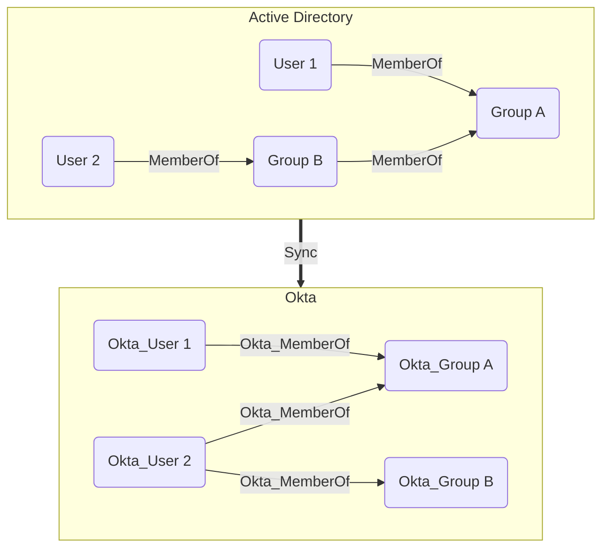

## Overview

Groups in Okta are collections of users that can be used to manage access to applications and resources. Groups can be created manually or synchronized from external directories such as Active Directory. The built-in **Everyone** group always contains all users in the Okta organization. Only users can be members of groups and groups cannot be nested.

Okta groups are represented as Okta_Group nodes.

## Synchronization with External Directories

Similarly to users, groups can also be synchronized from external directories. The Okta API exposes the original Active Directory attributes:


Nested (transitive) group memberships in Active Directory are always flattened (resolved) when synchronized to Okta, as illustrated below:



## Sample Property Values

Example of a group created directly in Okta:

```yaml
id: 00gxg12p4kFOkyXLb697
name: Engineering
display_name: Engineering
description: Engineering department group
okta_domain: contoso.okta.com
has_role_assignments: false
okta_group_type: OKTA_GROUP
object_class: okta:user_group
created: 2025-11-14T08:00:25+00:00
last_updated: 2025-11-14T08:00:25+00:00
last_membership_updated: 2025-11-14T08:00:25+00:00
```

Example of a group synchronized from Active Directory:

```yaml
id: 00gxga7s3yDJ71OzW697
name: Sales
display_name: Sales
description: Sales department group
okta_domain: contoso.okta.com
has_role_assignments: false
okta_group_type: APP_GROUP
object_class: okta:windows_security_principal
object_sid: S-1-5-21-71365889-924527929-2677699343-2536
distinguished_name: CN=Sales,CN=Groups,DC=contoso,DC=local
sam_account_name: Sales
domain_qualified_name: CONTOSO\Sales
group_scope: Global
group_type: Security
object_guid: 4ab65ef0-ab82-4017-b5ee-1c20facd4d6a
created: 2025-11-14T12:58:13+00:00
last_updated: 2025-11-14T13:05:44+00:00
last_membership_updated: 2025-11-14T12:58:13+00:00
```


## Edges

### Inbound Edges

| Edge | Source Node | Traversable |
| --- | --- | --- |
| [Okta_AddMember](/opengraph/extensions/okta/edges/okta_addmember) | [Okta_Application](/opengraph/extensions/okta/nodes/okta_application) | ✅ |
| [Okta_AddMember](/opengraph/extensions/okta/edges/okta_addmember) | Okta_Group | ✅ |
| [Okta_AddMember](/opengraph/extensions/okta/edges/okta_addmember) | [Okta_User](/opengraph/extensions/okta/nodes/okta_user) | ✅ |
| [Okta_Contains](/opengraph/extensions/okta/edges/okta_contains) | [Okta_Organization](/opengraph/extensions/okta/nodes/okta_organization) | ✅ |
| [Okta_GroupAdmin](/opengraph/extensions/okta/edges/okta_groupadmin) | [Okta_Application](/opengraph/extensions/okta/nodes/okta_application) | ✅ |
| [Okta_GroupAdmin](/opengraph/extensions/okta/edges/okta_groupadmin) | Okta_Group | ✅ |
| [Okta_GroupAdmin](/opengraph/extensions/okta/edges/okta_groupadmin) | [Okta_User](/opengraph/extensions/okta/nodes/okta_user) | ✅ |
| [Okta_GroupMembershipAdmin](/opengraph/extensions/okta/edges/okta_groupmembershipadmin) | [Okta_Application](/opengraph/extensions/okta/nodes/okta_application) | ✅ |
| [Okta_GroupMembershipAdmin](/opengraph/extensions/okta/edges/okta_groupmembershipadmin) | Okta_Group | ✅ |
| [Okta_GroupMembershipAdmin](/opengraph/extensions/okta/edges/okta_groupmembershipadmin) | [Okta_User](/opengraph/extensions/okta/nodes/okta_user) | ✅ |
| [Okta_GroupPull](/opengraph/extensions/okta/edges/okta_grouppull) | [Okta_Application](/opengraph/extensions/okta/nodes/okta_application) | ✅ |
| [Okta_IdpGroupAssignment](/opengraph/extensions/okta/edges/okta_idpgroupassignment) | [Okta_IdentityProvider](/opengraph/extensions/okta/nodes/okta_identityprovider) | ❌ |
| [Okta_MemberOf](/opengraph/extensions/okta/edges/okta_memberof) | [Okta_User](/opengraph/extensions/okta/nodes/okta_user) | ✅ |
| [Okta_MembershipSync](/opengraph/extensions/okta/edges/okta_membershipsync) | [Group](/resources/nodes/group) | ✅ |
| [Okta_MembershipSync](/opengraph/extensions/okta/edges/okta_membershipsync) | Okta_Group | ✅ |
| [Okta_OrgAdmin](/opengraph/extensions/okta/edges/okta_orgadmin) | [Okta_Application](/opengraph/extensions/okta/nodes/okta_application) | ✅ |
| [Okta_OrgAdmin](/opengraph/extensions/okta/edges/okta_orgadmin) | Okta_Group | ✅ |
| [Okta_OrgAdmin](/opengraph/extensions/okta/edges/okta_orgadmin) | [Okta_User](/opengraph/extensions/okta/nodes/okta_user) | ✅ |
| [Okta_ResourceSetContains](/opengraph/extensions/okta/edges/okta_resourcesetcontains) | [Okta_ResourceSet](/opengraph/extensions/okta/nodes/okta_resourceset) | ❌ |
| [Okta_ResourceSetContainsMembersOf](/opengraph/extensions/okta/edges/okta_resourcesetcontainsmembersof) | [Okta_ResourceSet](/opengraph/extensions/okta/nodes/okta_resourceset) | ❌ |
| [Okta_ScopedTo](/opengraph/extensions/okta/edges/okta_scopedto) | [Okta_RoleAssignment](/opengraph/extensions/okta/nodes/okta_roleassignment) | ❌ |

### Outbound Edges

| Edge | Destination Node | Traversable |
| --- | --- | --- |
| [Okta_AddMember](/opengraph/extensions/okta/edges/okta_addmember) | Okta_Group | ✅ |
| [Okta_AppAdmin](/opengraph/extensions/okta/edges/okta_appadmin) | [Okta_ApiServiceIntegration](/opengraph/extensions/okta/nodes/okta_apiserviceintegration) | ✅ |
| [Okta_AppAdmin](/opengraph/extensions/okta/edges/okta_appadmin) | [Okta_Application](/opengraph/extensions/okta/nodes/okta_application) | ✅ |
| [Okta_AppAssignment](/opengraph/extensions/okta/edges/okta_appassignment) | [Okta_Application](/opengraph/extensions/okta/nodes/okta_application) | ❌ |
| [Okta_GroupAdmin](/opengraph/extensions/okta/edges/okta_groupadmin) | Okta_Group | ✅ |
| [Okta_GroupAdmin](/opengraph/extensions/okta/edges/okta_groupadmin) | [Okta_User](/opengraph/extensions/okta/nodes/okta_user) | ✅ |
| [Okta_GroupMembershipAdmin](/opengraph/extensions/okta/edges/okta_groupmembershipadmin) | Okta_Group | ✅ |
| [Okta_GroupPush](/opengraph/extensions/okta/edges/okta_grouppush) | [Okta_Application](/opengraph/extensions/okta/nodes/okta_application) | ❌ |
| [Okta_HasRole](/opengraph/extensions/okta/edges/okta_hasrole) | [Okta_CustomRole](/opengraph/extensions/okta/nodes/okta_customrole) | ❌ |
| [Okta_HasRole](/opengraph/extensions/okta/edges/okta_hasrole) | [Okta_Role](/opengraph/extensions/okta/nodes/okta_role) | ❌ |
| [Okta_HasRoleAssignment](/opengraph/extensions/okta/edges/okta_hasroleassignment) | [Okta_RoleAssignment](/opengraph/extensions/okta/nodes/okta_roleassignment) | ❌ |
| [Okta_HelpDeskAdmin](/opengraph/extensions/okta/edges/okta_helpdeskadmin) | [Okta_User](/opengraph/extensions/okta/nodes/okta_user) | ✅ |
| [Okta_ManageApp](/opengraph/extensions/okta/edges/okta_manageapp) | [Okta_Application](/opengraph/extensions/okta/nodes/okta_application) | ✅ |
| [Okta_MembershipSync](/opengraph/extensions/okta/edges/okta_membershipsync) | [AZGroup](/resources/nodes/az-group) | ✅ |
| [Okta_MembershipSync](/opengraph/extensions/okta/edges/okta_membershipsync) | [Group](/resources/nodes/group) | ✅ |
| [Okta_MembershipSync](/opengraph/extensions/okta/edges/okta_membershipsync) | Okta_Group | ✅ |
| [Okta_MobileAdmin](/opengraph/extensions/okta/edges/okta_mobileadmin) | [Okta_Device](/opengraph/extensions/okta/nodes/okta_device) | ✅ |
| [Okta_OrgAdmin](/opengraph/extensions/okta/edges/okta_orgadmin) | [Okta_Device](/opengraph/extensions/okta/nodes/okta_device) | ✅ |
| [Okta_OrgAdmin](/opengraph/extensions/okta/edges/okta_orgadmin) | Okta_Group | ✅ |
| [Okta_OrgAdmin](/opengraph/extensions/okta/edges/okta_orgadmin) | [Okta_User](/opengraph/extensions/okta/nodes/okta_user) | ✅ |
| [Okta_ReadClientSecret](/opengraph/extensions/okta/edges/okta_readclientsecret) | [Okta_ClientSecret](/opengraph/extensions/okta/nodes/okta_clientsecret) | ✅ |
| [Okta_ResetFactors](/opengraph/extensions/okta/edges/okta_resetfactors) | [Okta_User](/opengraph/extensions/okta/nodes/okta_user) | ✅ |
| [Okta_ResetPassword](/opengraph/extensions/okta/edges/okta_resetpassword) | [Okta_User](/opengraph/extensions/okta/nodes/okta_user) | ✅ |
| [Okta_SuperAdmin](/opengraph/extensions/okta/edges/okta_superadmin) | [Okta_Organization](/opengraph/extensions/okta/nodes/okta_organization) | ✅ |

## Properties

| Name | Type | Source | Description |
| --- | --- | --- | --- |
| created | datetime | created | Creation timestamp reported by the source. |
| description | string &#124; null | profile.description if profile else None | Description recorded for this object when available. |
| displayname | string | profile_name or id | Readable label supplied by the source object. |
| distinguished_name | string &#124; null | profile.dn if profile and is_active_directory_group else None | Distinguished name recorded for this object when available. |
| domain_qualified_name | string &#124; null | profile.windows_domain_qualified_name if profile and is_active_directory_group else None | Domain qualified name recorded for this object when available. |
| environmentid | string | _lookup.org_id() | Graph ID of the containing Okta organization, normalized to uppercase. |
| group_scope | string &#124; null | profile.group_scope if profile and is_active_directory_group else None | [Group](/resources/nodes/group) scope recorded for this object when available. |
| group_type | string &#124; null | profile.group_type if profile and is_active_directory_group else None | [Group](/resources/nodes/group) type recorded for this object when available. |
| has_role_assignments | bool | _lookup.has_role_assignments(id, &#39;group&#39;) | Whether an administrative assignment was found for this principal. |
| id | string | id | Source identifier used to build the node ID. |
| last_membership_updated | datetime &#124; null | last_membership_updated | Last membership updated recorded for this object when available. |
| last_seen | datetime | NodeProperties.last_seen | Timestamp assigned when the collector converts the node. |
| last_updated | datetime &#124; null | last_updated | Last modification timestamp, when available. |
| name | string | profile_name or id | Name normalized to uppercase by the Okta node model. |
| object_class | string &#124; null | object_class | Object class recorded for this object when available. |
| object_guid | string &#124; null | _decode_object_guid(profile.external_id) if profile and is_active_directory_group else None | Object guid recorded for this object when available. |
| object_sid | string &#124; null | profile.object_sid if profile and is_active_directory_group else None | Object sid recorded for this object when available. |
| okta_domain | string | _extras[&#39;tenant&#39;] | Okta domain associated with the object. |
| okta_group_type | string | type | Okta group type recorded for this object when available. |
| sam_account_name | string &#124; null | profile.sam_account_name if profile and is_active_directory_group else None | Sam account name recorded for this object when available. |
| tenant | string | _lookup.org_id() | Identifier of the organization used as collection context. |
| tenant_domain | string | _extras[&#39;tenant&#39;] | Domain of the organization being collected. |
