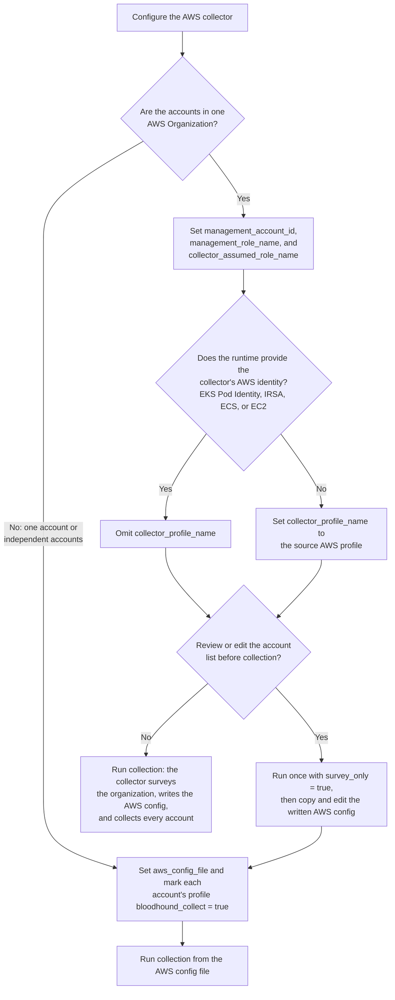

import AwsBetaNote from '/snippets/hounds/openhound-aws-beta-note.mdx';
import CollectionStrategy from '/snippets/hounds/aws-collection-strategy.mdx';


<AwsBetaNote />

This page covers configuring the OpenHound AWS collector for an AWS account or organization. Use this page to choose a collection strategy and configure the collector settings in the `secrets.toml` file or with environment variables.

## Prerequisites

Before you configure the AWS collector, ensure that the following prerequisites are met:

- [Collector client](/collect-data/enterprise-collection/create-collector) created in BloodHound Enterprise.
- AWS collector permissions [configured](/openhound/collectors/aws/configure-permissions) for the target AWS account or organization.

## Configure OpenHound

The AWS collector always collects from an AWS config file. It collects every profile in that file marked `bloodhound_collect = true`, and the AWS SDK resolves each profile's credentials and role chain as the file defines them. The collector gets the AWS config file in one of two ways:

- **Organization survey**: set `management_account_id`. At the start of each collection, the collector inventories the organization's active accounts, writes an AWS config file with one profile per account, and collects from it.
- **AWS config file**: set `aws_config_file` to a file you maintain. The collector uses the file as written and does not survey the organization.

You can set these values in one of two places:

| Method | Set the values here |
| --- | --- |
| `secrets.toml` file | `[sources.source.aws.credentials]` section |
| Environment variables | `SOURCES__SOURCE__AWS__CREDENTIALS` prefix |

<Warning>
  The beta must use the `openhound-aws` container image from the private ECR repository described in the [beta-only deployment example](/openhound/collectors/aws/collect-data#beta-only). The public `openhound` image does not support AWS collection.
</Warning>

## Choose an account collection strategy

<CollectionStrategy />

Use the following flowchart to decide which settings to configure:



Click the tab that matches the strategy of the AWS scope you want to collect.

<Tabs>
  <Tab title="Organization (source account)" icon="star">
    Use this recommended strategy when the collector runs with an AWS identity in a dedicated source account, such as a security tooling account. The identity comes from the collector's runtime, such as EKS Pod Identity, or from the AWS profile named in `collector_profile_name`.

    | Setting | Required | Default | Description |
    | --- | --- | --- | --- |
    | `management_account_id` | Yes | None | Account ID of the AWS Organizations management account to survey. |
    | `collector_assumed_role_name` | Yes | None | Name of the IAM role to assume in each active member account. |
    | `management_role_name` | No | Value of `collector_assumed_role_name` | Name of the IAM role that the source identity assumes in the management account. The collector uses it for the survey, AWS Organizations data, and management-account resources. |
    | `collector_assumed_role_session_name` | No | `openhound-aws-collection` | STS role session name written on every surveyed profile. |
    | `collector_profile_name` | No | Runtime identity | AWS SDK profile used as the source identity. If omitted, the collector uses the AWS identity available to its runtime. |
    | `runtime_auth_mode` | No | `auto` | How the collector selects runtime credentials when `collector_profile_name` is omitted: `auto`, `web_identity` (IRSA only), or `default_chain`. |
    | `survey_only` | No | `false` | Write the AWS config file and stop without collecting. See [Review the AWS config before collection](#review-the-aws-config-before-collection). |

    The source identity assumes the management role once. The management role lists the organization's active accounts and assumes the member-account role in each one. The collector always collects the management account and every enabled region.

    ```mermaid
    flowchart LR
      SRC["Source identity<br/>runtime identity or collector_profile_name"]

      subgraph MANAGEMENT["Management account"]
        MROLE["Management role<br/>management_role_name"]
        ORG["Organizations API<br/>active accounts, SCPs, and RCPs"]
        MRES["Management account resources"]
      end

      subgraph MEMBERS["Active member accounts"]
        CHILD1["Member account 1<br/>collector_assumed_role_name"]
        CHILD2["Member account 2<br/>collector_assumed_role_name"]
      end

      SRC -->|"AssumeRole: management_role_name"| MROLE
      MROLE --> ORG
      MROLE --> MRES
      MROLE -->|"AssumeRole: collector_assumed_role_name"| CHILD1
      MROLE -->|"AssumeRole: collector_assumed_role_name"| CHILD2
      ORG -. "returns active account IDs" .-> CHILD1
      ORG -. "returns active account IDs" .-> CHILD2
    ```

    The management role must trust the source identity. Each member-account role must trust the management role, and the management role must be allowed to assume it. Roles that AWS Organizations creates in member accounts trust the management account by default.

    ```toml title="~/.dlt/secrets.toml"
    [sources.source.aws.credentials]
    management_account_id = "111111111111"
    management_role_name = "ManagementCollectorRole"
    collector_assumed_role_name = "OpenHoundCollectorRole"
    ```

    Add `collector_profile_name = "security-tooling"` to use an AWS profile as the source identity instead of the runtime identity.

    **Environment variables**

    ```bash
    SOURCES__SOURCE__AWS__CREDENTIALS__MANAGEMENT_ACCOUNT_ID="111111111111"
    SOURCES__SOURCE__AWS__CREDENTIALS__MANAGEMENT_ROLE_NAME="ManagementCollectorRole"
    SOURCES__SOURCE__AWS__CREDENTIALS__COLLECTOR_ASSUMED_ROLE_NAME="OpenHoundCollectorRole"
    ```
  </Tab>
  <Tab title="Organization (management account)">
    Use this alternative when the collector's AWS identity is already the management role in the organization's management account. The settings are the same as the source account strategy. Set `management_role_name` to the name of that role: when the collector detects that its identity is already this role, it does not assume the role again, and assumes `collector_assumed_role_name` in each member account directly.

    Provide the management-role identity through `collector_profile_name`, for example a profile with `role_arn` and `source_profile` or `credential_source`, or through runtime credentials that already assume the role. Credentials supplied only as environment variables cannot fill this role.

    ```toml title="~/.dlt/secrets.toml"
    [sources.source.aws.credentials]
    management_account_id = "111111111111"
    management_role_name = "ManagementCollectorRole"
    collector_assumed_role_name = "OpenHoundCollectorRole"
    collector_profile_name = "management"
    ```

    **Environment variables**

    ```bash
    SOURCES__SOURCE__AWS__CREDENTIALS__MANAGEMENT_ACCOUNT_ID="111111111111"
    SOURCES__SOURCE__AWS__CREDENTIALS__MANAGEMENT_ROLE_NAME="ManagementCollectorRole"
    SOURCES__SOURCE__AWS__CREDENTIALS__COLLECTOR_ASSUMED_ROLE_NAME="OpenHoundCollectorRole"
    SOURCES__SOURCE__AWS__CREDENTIALS__COLLECTOR_PROFILE_NAME="management"
    ```
  </Tab>
  <Tab title="Single-account">
    Use an AWS config file with one profile marked for collection to collect resources from one AWS account. The collector does not survey an organization in this mode.

    | Setting | Required | Default | Description |
    | --- | --- | --- | --- |
    | `aws_config_file` | Yes | None | Path to the AWS config file to collect from. |
    | `credentials_file` | No | None | Path to an AWS shared credentials file, for profiles that reference static credentials. |

    Mark the profile with `bloodhound_collect = true`. Any AWS SDK profile works, including IAM Identity Center (SSO), `credential_process`, and role chains.

    ```ini title="openhound-aws-config"
    [profile production]
    role_arn = arn:aws:iam::222222222222:role/OpenHoundCollectorRole
    source_profile = security-tooling
    bloodhound_collect = true

    [profile security-tooling]
    sso_session = security
    sso_account_id = 999999999999
    sso_role_name = OpenHoundSource

    [sso-session security]
    sso_start_url = https://example.awsapps.com/start
    sso_region = us-east-1
    ```

    The collector uses profiles without `bloodhound_collect = true`, such as `security-tooling` above, only as `source_profile` links.

    **`secrets.toml`**

    ```toml title="~/.dlt/secrets.toml"
    [sources.source.aws.credentials]
    aws_config_file = "/app/.aws/openhound-aws-config"
    ```

    **Environment variables**

    ```bash
    SOURCES__SOURCE__AWS__CREDENTIALS__AWS_CONFIG_FILE="/app/.aws/openhound-aws-config"
    ```
  </Tab>
  <Tab title="Multiple independent-accounts">
    Use an AWS config file with one profile marked for collection per account to collect resources from multiple independent AWS accounts. The settings are the same as single-account collection.

    ```ini title="openhound-aws-config"
    [profile production]
    sso_session = security
    sso_account_id = 222222222222
    sso_role_name = OpenHoundCollector
    bloodhound_collect = true

    [profile testing]
    sso_session = security
    sso_account_id = 333333333333
    sso_role_name = OpenHoundCollector
    bloodhound_collect = true

    [sso-session security]
    sso_start_url = https://example.awsapps.com/start
    sso_region = us-east-1
    ```

    If two profiles resolve to the same account, the collector collects that account once.

    **`secrets.toml`**

    ```toml title="~/.dlt/secrets.toml"
    [sources.source.aws.credentials]
    aws_config_file = "/app/.aws/openhound-aws-config"
    ```

    **Environment variables**

    ```bash
    SOURCES__SOURCE__AWS__CREDENTIALS__AWS_CONFIG_FILE="/app/.aws/openhound-aws-config"
    ```
  </Tab>
</Tabs>

### AWS config file keys

The collector reads two keys from the profiles in an AWS config file, in addition to the standard AWS SDK settings:

| Key | Description |
| --- | --- |
| `bloodhound_collect = true` | Collect this profile's account. |
| `bloodhound_organization_management = true` | This profile also supplies AWS Organizations data. Set it on at most one profile that also sets `bloodhound_collect = true`. |

When a profile cannot authenticate, the collector logs an error, skips that profile, and continues with the others. If the skipped profile is the `bloodhound_organization_management` profile, the collector collects no AWS Organizations data. Collection fails when no profile authenticates. A failed organization survey stops collection before any profile is used. The collector collects regional resources in every enabled region. For AWS STS and region discovery, it uses `AWS_DEFAULT_REGION` when set, otherwise the profile's `region`, otherwise `AWS_REGION`, and otherwise `us-east-1`.

## Review the AWS config before collection

Use `survey_only` to inspect the AWS config file that the organization survey writes, or to edit it before collection, for example to exclude an account or to use a different role in one account.

<Steps>
  <Step title="Write the AWS config file">
    Add `survey_only = true` to the organization settings and run collection. The collector surveys the organization, writes the AWS config file, prints its path, and stops without collecting.

    The file is written to `$XDG_CONFIG_HOME/openhound/aws/config`, or `~/.config/openhound/aws/config` when `XDG_CONFIG_HOME` is not set. Each survey first copies the previous file to `config.<timestamp>.bak` in the same directory. In a container, these files are lost when the container restarts unless the directory is on a mounted volume.
  </Step>
  <Step title="Edit a copy of the file">
    Copy the file to a location the collector can read, then edit the copy. Remove `bloodhound_collect = true` from a profile to skip its account. The management profile is named `openhound-management`, or keeps the name of the `collector_profile_name` profile when that profile already is the management role. Each member profile is named `openhound-account-<account-id>`.

    The surveyed file refers to the runtime identity, such as `credential_source = EcsContainer`, so it is valid only where the survey ran. To use it elsewhere, replace that entry with a source that works in the new location.
  </Step>
  <Step title="Collect from the edited file">
    Set `aws_config_file` to the edited copy and remove `survey_only`. The collector now uses the file as written and no longer surveys the organization, so accounts added to the organization later are not collected until you add them to the file.
  </Step>
</Steps>

## Configure S3 collection

S3 bucket collection is disabled by default. Enable it with the `bucket_policy.include` setting, then define bucket and object rules to control which S3 objects the collector stores for processing.

| Setting | Required | Default | Description |
| --- | --- | --- | --- |
| `include` | No | `false` | Enables S3 bucket collection. |
| `max_objects` | No | `10` | Maximum number of objects to collect from each included bucket. Set to `0` to skip object collection. |
| `rule.include` | No | `true` | Includes or excludes matching buckets or objects. Exclusion rules take precedence. |
| `rule.match_bucket` | No | None | Regular expression matched against the S3 bucket name. |
| `rule.match_object` | No | None | Regular expression matched against the S3 object key. |

Buckets and objects are excluded from object collection by default. A bucket or object must match at least one rule where `include` is `true`. If a bucket or object also matches a rule where `include` is `false`, the exclusion wins.

```toml
[sources.source.aws.bucket_policy]
include = true
max_objects = 100

[[sources.source.aws.bucket_policy.rule]]
include = true
match_bucket = "^production.*$"

[[sources.source.aws.bucket_policy.rule]]
include = false
match_bucket = ".*logs.*"

[[sources.source.aws.bucket_policy.rule]]
include = true
match_object = "\\.(json|csv)$"

[[sources.source.aws.bucket_policy.rule]]
include = false
match_object = ".*secret.*"
```

<Note>
  Bucket and object filters apply after AWS API responses are returned. Excluded buckets or objects can still appear in API responses, but the collector does not store excluded objects for further processing.
</Note>

## Configuration examples

The following examples show how to configure the AWS collector for different collection strategies. Replace placeholder values with your own.

### Single-account collection without buckets

```toml 
[destination.bloodhoundenterprise]
token_key = "<BHE_TOKEN_KEY>"
token_id = "<BHE_TOKEN_ID>"
url = "https://your-tenant.bhe.io"

[sources.source.aws.credentials]
aws_config_file = "<PATH_TO_AWS_CONFIG_FILE>"

[sources.source.aws.bucket_policy]
include = false
max_objects = 0
```

### Single-account collection with all buckets

```toml
[destination.bloodhoundenterprise]
token_key = "<BHE_TOKEN_KEY>"
token_id = "<BHE_TOKEN_ID>"
url = "https://your-tenant.bhe.io"

[sources.source.aws.credentials]
aws_config_file = "<PATH_TO_AWS_CONFIG_FILE>"

[sources.source.aws.bucket_policy]
include = true
max_objects = 50

[[sources.source.aws.bucket_policy.rule]]
include = true
match_bucket = ".*"

[[sources.source.aws.bucket_policy.rule]]
include = true
match_object = ".*"
```

### Multiple independent-account collection without buckets

Mark one profile per account with `bloodhound_collect = true` in the AWS config file.

```toml
[destination.bloodhoundenterprise]
token_key = "<BHE_TOKEN_KEY>"
token_id = "<BHE_TOKEN_ID>"
url = "https://your-tenant.bhe.io"

[sources.source.aws.credentials]
aws_config_file = "<PATH_TO_AWS_CONFIG_FILE>"

[sources.source.aws.bucket_policy]
include = false
max_objects = 0
```

### Organization collection from a dedicated source account

```toml
[destination.bloodhoundenterprise]
token_key = "<BHE_TOKEN_KEY>"
token_id = "<BHE_TOKEN_ID>"
url = "https://your-tenant.bhe.io"

[sources.source.aws.credentials]
management_account_id = "<AWS_MANAGEMENT_ACCOUNT_ID>"
management_role_name = "ManagementCollectorRole"
collector_assumed_role_name = "OpenHoundCollectorRole"
collector_assumed_role_session_name = "OpenHoundCollectorSession"
# Omit to use the runtime identity, such as EKS Pod Identity.
collector_profile_name = "<AWS_SOURCE_PROFILE_NAME>"

[sources.source.aws.bucket_policy]
include = false
max_objects = 0
```

### Organization collection from the management account

Use this alternative when the collector's AWS identity is already the management role in the AWS Organizations management account.

```toml
[destination.bloodhoundenterprise]
token_key = "<BHE_TOKEN_KEY>"
token_id = "<BHE_TOKEN_ID>"
url = "https://your-tenant.bhe.io"

[sources.source.aws.credentials]
management_account_id = "<AWS_MANAGEMENT_ACCOUNT_ID>"
management_role_name = "ManagementCollectorRole"
collector_assumed_role_name = "OpenHoundCollectorRole"
collector_assumed_role_session_name = "OpenHoundCollectorSession"
collector_profile_name = "<AWS_MANAGEMENT_PROFILE_NAME>"

[sources.source.aws.bucket_policy]
include = false
max_objects = 0
```

## Upgrade from earlier beta versions

`openhound-aws` 0.4.0 replaces the earlier AWS credential settings. Collection fails at startup when a removed setting is configured, and the error names its replacement.

| Removed setting | Replacement |
| --- | --- |
| `profile_name` | `collector_profile_name` for the survey's source identity, or a profile in `aws_config_file` |
| `profile_names` | `aws_config_file` with one `bloodhound_collect = true` profile per account |
| `org_role_name` | `collector_assumed_role_name` |
| `org_role_session_name` | `collector_assumed_role_session_name` |
| `source_account` | None; the source identity is `collector_profile_name` or the runtime identity |
| `include_management_account` | None; the management account is always collected |
| `region_name` | None; every enabled region is collected |
| `auto_generate_config` | None; the survey runs when `aws_config_file` is unset |
| `generated_config_dir`, `config_file` | `aws_config_file` |
| `stop_after_config_generation` | `survey_only` |

The collector now assumes member-account roles through the management role instead of directly from the source identity. Update member-account role trust policies to trust the management role before you upgrade.

## Troubleshoot the organization survey

| Symptom | Resolution |
| --- | --- |
| `Cannot survey the AWS organization: failed to authenticate role ...` | The source identity cannot assume `management_role_name` in the management account, or the role cannot list the organization's accounts. Check the source credentials, the management role's trust policy, and its `organizations:ListAccounts` permission. |
| `Set aws_config_file to collect from an AWS config, or management_account_id to survey the organization and build one` | Set one of the two settings. |
| `collector_assumed_role_name is required to survey the organization` | Set `collector_assumed_role_name` when you set `management_account_id`. |
| `Skipping AWS profile ...: failed to authenticate` | The collector could not authenticate that profile, for example because the member-account role is missing or does not trust the management role. Collection continues with the other accounts. When the message ends with `AWS Organizations data is not collected`, the skipped profile is the management profile. |
| `No AWS profile in ... could authenticate; nothing to collect` | Collection stopped because every profile failed. Check the source credentials and the role chain of each profile. |

## Deployment examples

Before continuing, ensure that a valid `secrets.toml` file is available and contains the BloodHound Enterprise credentials, the AWS credential settings for your collection strategy, and optionally bucket collection policies. If `collector_profile_name` is omitted, the organization survey uses the AWS identity available to the collector's runtime.

<Note>
  The Compose examples assume that the secrets file is stored in the user's home directory at `~/.dlt/secrets.toml`. The Compose template mounts your AWS config and credentials files at `/app/.aws/config` and `/app/.aws/credentials`: set `collector_profile_name` to a profile in that config, or set `aws_config_file = "/app/.aws/config"` to collect from it directly.
</Note>

### BETA ONLY

The `openhound-aws` container image is available from the following private ECR repository:

```text
ec-e7d32cd970094ca9839c97a7c4abb4d2.ecs.us-east-2.on.aws
```

<Note>
  The password to the private container repository will be provided by SpecterOps.
</Note>

<Steps>
  <Step title="Log in to the private repository">
    Configure the Docker CLI to authenticate to the private repository. When prompted for the password, enter the SpecterOps-provided repository password.

    ```bash
    docker login --username ecr-proxy ec-e7d32cd970094ca9839c97a7c4abb4d2.ecs.us-east-2.on.aws
    ```
  </Step>

  <Step title="Pull the OpenHound AWS image">
    Test that you can pull the `openhound-aws` image. You can replace `docker` with `podman` if needed.

    ```bash
    docker pull ec-e7d32cd970094ca9839c97a7c4abb4d2.ecs.us-east-2.on.aws/openhound/openhound-aws:latest
    ```
  </Step>

  <Step title="Create the Docker Compose file">
    Save the following Compose template as a `docker-compose.yaml` file, then run `docker compose up` to start the collector.

    ```yaml title="docker-compose.yaml"
    x-scheduler: &scheduler
      image: ec-e7d32cd970094ca9839c97a7c4abb4d2.ecs.us-east-2.on.aws/openhound/openhound-aws:latest
      restart: unless-stopped
      init: true

      environment: &env
        LOG_LEVEL: INFO
        EXTRACT__WORKERS: 8
        LOG_CONTAINER: true

    services:
      scheduler-aws:
        <<: *scheduler
        environment:
          <<: *env
          DESTINATION__BLOODHOUNDENTERPRISE__COLLECTOR_NAME: aws
          AWS_CONFIG_FILE: /app/.aws/config
          AWS_SHARED_CREDENTIALS_FILE: /app/.aws/credentials

        secrets:
          - source: secrets_aws
            target: /app/.dlt/secrets.toml

          - source: config_aws
            target: /app/.aws/config

          - source: credentials_aws
            target: /app/.aws/credentials

    secrets:
      secrets_aws:
        file: ${HOME}/.dlt/secrets.toml

      config_aws:
        file: ${HOME}/.aws/config

      credentials_aws:
        file: ${HOME}/.aws/credentials
    ```
  </Step>
</Steps>
